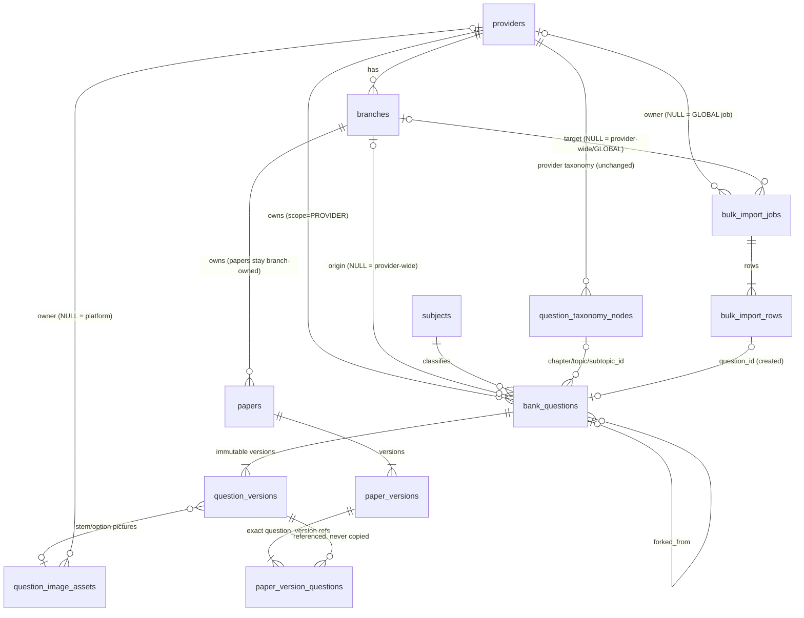

# Three-Scope Question Bank and Bulk Import — Architecture Proposal

Status: **IMPLEMENTED in the working tree (2026-11-20), not deployed.** Migration `0014` has been run only on a disposable
PostgreSQL; no Neon database, container or deployment has been changed. Implementation notes: §23.
Date: 2026-11-20. Builds on the approved Phases A–F in `BULK_QUESTION_IMPORT_PLAN.md`.

Legend: **[EXISTING]** what the code does today (read from source) · **[PROPOSED]** what changes · **[REC]** recommendation, open for your decision.

---

## 1. Current architecture findings (from the code)

| # | Finding | Where |
|---|---|---|
| F1 | **[EXISTING]** There is one question table, `bank_questions`, with `scope ∈ {GLOBAL, PROVIDER}`. The CHECK says a GLOBAL question has no provider and no branch, and a PROVIDER question has **both** a provider and a branch. There is no provider-wide question today. | `institute_common/models/papers.py:166` |
| F2 | **[EXISTING]** Content lives in immutable `question_versions`. Papers reference exact `question_version_id`s through `paper_version_questions`, and exams reference paper versions. Bank edits create new versions and never change built papers or exams. | `papers.py` models, `build_paper` (`routes/papers.py:1059`) |
| F3 | **[EXISTING]** Non-platform users can see provider questions only branch by branch. `_question_visibility` filters `Question.branch_id == branch_id`, so a Thane Branch Admin **cannot** see or use Mumbai's questions today. A Teacher sees only the subjects they teach in that branch. | `routes/papers.py:513` |
| F4 | **[EXISTING]** Paper building is "own provider + `question.read` on the question's **origin branch**". A Branch Admin therefore cannot build a paper from another branch's question. | `_check_build`, `routes/papers.py:1128` |
| F5 | **[EXISTING]** Papers are branch-owned (`papers_scope_check`). The exam service reads only **paper versions** and never filters questions by branch. Its paper checks use `paper.branch_id`. | `inst_exam/routes/tests.py:347` `paper_problem`, `services/exam_generation.py`, `services/outbox.py` |
| F6 | **[EXISTING]** Correcting a question that is not in the paper's own scope (`(scope, provider, branch)` equal) **forks** a copy (`forked_from_question_id`). Across branches this creates a duplicate today. | `revise_paper` / `owns_for_versioning`, `routes/papers.py:1446,1578` |
| F7 | **[EXISTING]** The taxonomy is **already provider-wide**. `question_taxonomy_nodes`/`aliases` are keyed by `(provider_id, subject_id)` and have no branch, so branch imports already resolve against the provider's shared taxonomy. GLOBAL questions keep plain-text labels (`link_question` skips them). | `models/papers.py:104`, `services/taxonomy.py:194` |
| F8 | **[EXISTING] gap:** `GET /question-taxonomy/nodes` requires `question.read` for the provider with **no branch**. `Principal.can` returns False for a Branch Admin when no branch is given, so a Branch Admin cannot list the provider taxonomy, even though their imports use it. | `routes/taxonomy.py:131`, `core/security.py:115` |
| F9 | **[EXISTING]** Bulk-import duplicate detection is **already provider-wide**: `bank_hashes(provider_id, subject_id)` covers every branch of the provider, ACTIVE questions only, using a normalized text and picture checksum. | `services/bulk_validation.py:58` |
| F10 | **[EXISTING]** Bulk import jobs **require** both `provider_id` and `branch_id` (NOT NULL). Upload, history, the worker re-check, the active-job limit and the import itself are all written for one branch. | `models/bulk_import.py`, `routes/bulk_imports.py:187`, `services/bulk_import.py:101,337,435` |
| F11 | **[EXISTING]** Pictures (`question_image_assets`) are **provider-owned** (`provider_id NOT NULL`, unique `(provider_id, checksum)`). Delivery allows any staff with an assignment in that provider (`can_see_provider`), so branch sharing of pictures already works. There is no platform-owned picture. | `models/papers.py:37`, `routes/papers.py:1009` |
| F12 | **[EXISTING] gap:** a provider paper copied into GLOBAL (`routes/internal.py:233`) keeps the **provider's** picture assets. Staff of other providers get 404 for those pictures in the portal. Students are unaffected because delivery embeds the pictures. | `routes/internal.py`, `routes/papers.py:1015` |
| F13 | **[EXISTING]** There are no per-staff permission grants. Permissions come only from the 5 roles (`ROLE_PERMISSIONS`). "Platform Admin" in the portal is the `ADMIN` role in code. | `core/roles.py` |
| F14 | **[EXISTING]** A paper cannot contain the same `question_id` twice (validator). There is no check against two *different* questions with identical content. | `PaperBuildIn.rules`, `routes/papers.py:247` |
| F15 | **[EXISTING]** Platform questions used in a Global Test are *reserved*. Their answers are hidden from provider staff, and providers cannot build them into papers. | `AnswerPolicy`, `reserved_question_ids` |

**Conclusion:** the platform bank, provider taxonomy, provider-wide duplicate detection and immutable snapshots already exist. What is missing:
- provider-wide **visibility**;
- a question owned by the provider with **no branch**;
- scope-aware **bulk import jobs**;
- **platform-owned pictures** for Global imports.

---

## 2. Final three-scope ownership architecture [PROPOSED]

There is still **one** question table and **one** row per question. No copies are made per branch.

| Scope (portal name) | `scope` | `provider_id` | `branch_id` | Meaning |
|---|---|---|---|---|
| Platform (Global) | `GLOBAL` | NULL | NULL | Platform-owned. Unchanged. |
| Provider-wide | `PROVIDER` | provider | **NULL** | Uploaded centrally by the provider. |
| Branch-specific | `PROVIDER` | provider | origin branch | Uploaded by a branch. `branch_id` now means **originating branch**, not "visible only here". |

**Sharing rule (finalized):** every `PROVIDER` question is visible to and usable by **all branches of its provider**, whatever its `branch_id`. Visibility is decided by `provider_id`. `branch_id` only records origin and decides who may *edit* the question.

Alternatives considered and rejected:
- A `question_branch_access` join table: it duplicates the sharing rule in data and needs rows written for every new branch.
- A new `origin_branch_id` column replacing `branch_id`: it breaks the API (`BankQuestionOut.branch_id`) and needs a backfill, for no gain.
- A third `scope` value `BRANCH`: it would need a backfill of the 437 existing rows and changes in every `scope == "PROVIDER"` check, while giving nothing that `branch_id IS NULL` does not already express.

## 3. Proposed ER diagram



Changed relationships:
- `bank_questions.branch_id` is now optional for PROVIDER questions.
- `question_image_assets.provider_id` becomes nullable (NULL = platform picture).
- `bulk_import_jobs` gets a `scope`, an optional provider and an optional branch.

## 4. Question ownership and sharing rules [PROPOSED]

1. A GLOBAL question is readable by all staff with `question.read`, except for the answers of reserved Global Test questions (F15, unchanged). Only SUPER_ADMIN/ADMIN create, edit or archive it (unchanged).
2. A PROVIDER question (provider-wide or branch-origin) is readable by every staff member of **that provider** with `question.read`, subject to the Teacher subject rule (D2). Staff of other providers never see it: the result is the same "not found" as a missing question.
3. Who edits or archives:
   - provider-wide question: Provider Admin and platform roles;
   - branch-origin question: Provider Admin, the Branch Admin of the **origin** branch, and the Teacher who owns it (unchanged rule, `_can_edit_question`).
   - Other branches **use** the question but do not edit it.
4. Correcting a question inside a paper:
   - **[REC]** relax `owns_for_versioning` from "same provider **and same branch**" to "same provider **and** the caller may edit the question". A Provider Admin's correction then becomes the next version of the shared question instead of a fork.
   - A Branch Admin correcting another branch's question still gets a fork, which is the existing behaviour and a legitimate variant.
5. New versions never change existing papers or exams (F2). Other branches' **new** papers pick up the latest version.
6. Archiving hides the question from every branch's bank. Papers and exams that already use it are unaffected (existing behaviour).

## 5. Taxonomy ownership model [PROPOSED: minimal]

- **Provider taxonomy:** unchanged. It is already provider-wide (F7), so branch-origin and provider-wide imports resolve against the same records. No branch taxonomy is needed.
- **Platform taxonomy:** **[REC] not built now.** GLOBAL questions keep plain-text labels (existing behaviour).
  - A GLOBAL bulk import still requires a Chapter. Labels are cleaned and length-checked with the existing `clean_label`/`label_key`, and are stored as text.
  - No `TAXONOMY_UNMATCHED` errors are raised for GLOBAL jobs. The taxonomy-issue and resolution endpoints answer `409 NOT_APPLICABLE` for them.
- **No cross-scope merging:** provider records never match GLOBAL labels or another provider's records. The existing `node.provider_id != job.provider_id` refusal is kept.
- **Fix F8:** reading the provider taxonomy uses the new provider-bank read rule (§9), so Branch Admins and Teachers can list it. Changes still need `taxonomy.manage` (Provider Admin and platform roles, unchanged).
- *Deferred design* (only if you later want platform taxonomy):
  - make `question_taxonomy_nodes.provider_id` nullable;
  - add partial unique indexes on `(subject_id, name_key) WHERE provider_id IS NULL AND parent_id IS NULL` (and the alias equivalents);
  - add a backfill that turns the existing GLOBAL text labels into platform records.

## 6. Bulk Import workflow, all three scopes [PROPOSED]

One shared workflow: the same job, rows, worker, preview, correction, revalidation, confirmation and CSV report. Only the **target** differs.

```
GET /bulk-imports/targets  ──►  page shows only the targets the server returns
          │
 ┌────────┼─────────────────────────┬──────────────────────────────┐
 Platform (GLOBAL)          Provider-wide                  Branch-specific
 subject: all ACTIVE        provider: from targets          provider: from targets
 subjects                   (auto if only one)              branch: authorized branches
                            subject: offered by provider    subject: offered + permitted
 └────────┴──────── upload → PARSING → PREVIEW ⇄ correct/resolve/revalidate → confirm → IMPORT → history/report
```

| Step | GLOBAL | Provider-wide | Branch-specific |
|---|---|---|---|
| Duplicate check against | GLOBAL questions of the subject | the provider's questions of the subject (all branches + provider-wide) | same as provider-wide (F9, unchanged) |
| Taxonomy | plain text, no resolution | provider taxonomy | provider taxonomy |
| Pictures saved as | platform assets (`provider_id NULL`) | provider assets | provider assets |
| Created question | `GLOBAL, NULL, NULL` | `PROVIDER, provider, NULL` | `PROVIDER, provider, branch` |
| Active-job limit bucket | platform | provider | provider |
| History shown at | target = Platform | target = provider (provider-wide jobs) | branch (unchanged) |

## 7. Permission matrix [PROPOSED]

✔ = allowed · ✖ = denied · "own" = only their own uploads/questions · ★ = needs your decision (§20)

| Action | Super Admin | Platform Admin (`ADMIN`) | Provider Admin | Branch Admin | Teacher |
|---|---|---|---|---|---|
| View GLOBAL questions | ✔ | ✔ | ✔ (reserved answers hidden) | ✔ (same) | ✔ (same) |
| Create, edit or archive GLOBAL; GLOBAL bulk import | ✔ | ✔ | ✖ | ✖ | ✖ |
| View PROVIDER questions | all providers | all providers | own provider, all branches | **own provider, all branches** (new) | own provider, subjects they teach ★D2 |
| Provider-wide bulk import / create | ✔ ★D3 | ✔ ★D3 | ✔ | ✖ ★D1 | ✖ |
| Edit or archive a provider-wide question | ✔ | ✔ | ✔ | ✖ | ✖ |
| Branch-specific bulk import | ✔ ★D3 | ✔ ★D3 | ✔ any branch | own branch | branches/subjects they teach (unchanged) |
| Edit or archive a branch-origin question | ✔ | ✔ | ✔ | origin branch only | own questions only |
| Use any visible question in own papers/exams | ✔ (GLOBAL papers: GLOBAL only) | ✔ | ✔ | ✔ (new: other branches) | ✔ within their subjects |
| Taxonomy read | ✔ | ✔ | ✔ | ✔ (fix F8) | ✔ |
| Taxonomy manage (create, rename, alias, map in import) | ✔ | ✔ | ✔ | ✖ | ✖ |
| Import history and report | all | all | own provider: all jobs | own branch | own jobs |

**No new permission strings and no new grants for existing roles.**
- "Provider-wide manage" is `question.manage` checked at **provider level with Teachers excluded**. `Principal.can` already returns True only for Provider Admin and platform roles there.
- What changes for existing roles is **visibility**: Branch Admins and Teachers will see other branches' questions of their provider. That is the finalized sharing rule.

## 8. Duplicate detection design [PROPOSED]

- **Owner bucket:**
  - GLOBAL job → active GLOBAL questions of the subject;
  - provider-wide or branch job → active PROVIDER questions of `(provider, subject)`, all branches plus provider-wide. This is already today's query (F9).
  - `bank_hashes` gets an explicit owner argument instead of relying on `provider_id == None`.
- **Unchanged:**
  - within-file duplicates (the first occurrence wins);
  - re-checks at revalidation and before each import batch;
  - DUPLICATE rows are reported and never imported;
  - no canonical record is ever duplicated by the importer.
- Questions of other providers are never compared (the bucket is filtered by provider).
- **GLOBAL content in provider imports:** **[REC] not counted** (★D4). Counting it would reveal to provider staff that their file matches a reserved Global Test question, and reserved questions cannot be reused anyway.
- **Limitations (existing, unchanged):**
  - Exact match only, after normalization (text with whitespace and case normalized, plus picture checksums). Reworded questions and option reordering are not detected.
  - Archived questions are not counted.
  - There is no database UNIQUE on content. Two jobs of the same provider importing the same new content at the same moment could both pass; the per-batch re-read narrows that window but does not close it.

## 9. Exam creation and question selection impact [PROPOSED]

- **Paper service:**
  - `_question_visibility` (bank search and `/question-taxonomy` filters) gets a PROVIDER branch: `provider_id = X` + subject rule. `branch_id` becomes an optional *context*, used to derive the provider. A new optional `origin` filter (`PROVIDER_WIDE` | `BRANCH`) and `origin_branch_id` are added.
  - `_check_build` "usable" check becomes: same provider + provider-bank read rule for the subject. This replaces "read on the origin branch".
  - **[REC]** In `_check_build`, reject a paper that contains two *different* questions with identical content, for example the same text in GLOBAL and PROVIDER (F14). The error is "Positions 3 and 17 are the same question".
  - `owns_for_versioning` is relaxed (§4.4).
- **Exam service:** **no change.** Papers stay branch-owned and exams reference paper versions (F5). Paper versions and `paper_version_questions` are immutable, so generated exams and historical results cannot change.
- **Student services:** no change.
- **Not affected:** marking rules (Phase A), RULES/UNIFORM/PER_QUESTION, negative marking, reserved Global Test protection, composite/shared papers (`paper_shares`), and Global contributions (they use papers).

## 10. API changes [PROPOSED; all backward compatible]

| API | Change |
|---|---|
| `GET /api/v1/bulk-imports/targets` | **New.** Returns the targets the caller may use, computed server-side: `{global: {subjects}|null, providers: [{provider_id, name, provider_wide: bool, subjects, branches: [{branch_id, name, subjects}]}]}`. |
| `POST /api/v1/bulk-imports` | Adds a form field `target` = `GLOBAL` \| `PROVIDER` \| `BRANCH`. `provider_id` is required for PROVIDER, unless the caller belongs to exactly one provider. Without `target`, the old `branch_id` + `subject_id` call means BRANCH, so it is unchanged. |
| `GET /api/v1/bulk-imports` | Accepts `target=GLOBAL`, or `provider_id` (provider-level history), or `branch_id` (unchanged). |
| `JobOut` | Adds `scope`. `provider_id` and `branch_id` become nullable. |
| `GET /bulk-imports/{id}/taxonomy-issues`, `POST …/taxonomy-resolutions` | Answer `409 NOT_APPLICABLE` for GLOBAL jobs. |
| `GET /api/v1/questions` | For PROVIDER scope, `branch_id` is no longer required for non-platform users: the provider comes from `provider_id`, `branch_id` or the caller's single provider. Results are provider-wide. Adds `origin` and `origin_branch_id` filters. |
| `POST /api/v1/questions` | **[REC] ★D8** Accepts `scope=PROVIDER` with `provider_id` and no `branch_id` for a provider-wide single question (Provider Admin). |
| `GET /api/v1/question-images/{id}` | Platform assets (`provider_id NULL`) are readable by staff with `paper.read`. ★D5: provider assets referenced by a GLOBAL question version become readable by all staff (fixes F12). |
| `GET /question-taxonomy/nodes`, `/match` | Read uses the provider-bank rule (fixes F8). |
| `GET /branches/{id}/questions` (legacy, unused by the portal) | Unchanged: lists questions **originating** in that branch. |

## 11. Background worker changes [PROPOSED]

- `permission_problem(job, staff)` becomes scope-aware. It still runs at every claim.
  - **GLOBAL:** the account is active, it is a platform role holding `question.manage`, and the subject is ACTIVE.
  - **Provider-wide:** the provider is active, the subject is offered, and `question.manage` holds at provider level with Teachers excluded.
  - **Branch:** existing rules. The teacher-own-upload rule is unchanged for all scopes.
- `_import_row` sets scope, provider and branch from the job. For GLOBAL, it skips taxonomy ids and stores the text labels.
- `_final_pictures`, `store_images` and `question_image_key` accept "platform" (`provider_id None`), with key prefix `question-images/platform/<sha256>`.
- `bank_hashes`, `active_jobs` and the `cleanup` concurrency check use the job's owner bucket.
- No queue, lease or idempotency changes. There is still one worker container and no Redis.

## 12. Frontend changes [PROPOSED]

- **Bulk Import page:**
  - a target chooser built **only** from `/bulk-imports/targets`, with no role-label logic;
  - the provider is auto-selected when there is only one;
  - the branch picker appears only for Branch-specific;
  - subjects come from the target;
  - history is filtered by target;
  - the existing preview, correction, taxonomy, confirmation and report components are reused;
  - the taxonomy panel is hidden for GLOBAL.
- **Question Bank:**
  - the provider view no longer needs a branch (it shows "Provider question bank");
  - an "Origin" column (Provider-wide / branch name) and an origin filter are added;
  - `can_edit` keeps coming from the server.
- **Test wizard and paper builder:** the picker (`QuestionBrowser source="ALL"`) automatically shows provider-wide and other-branch questions. The selection map already prevents picking the same question twice.
- **Types:** `JobOut.branch_id`/`provider_id` become nullable and `scope` is added. `BankQuestion` is already nullable.

## 13. Migration plan [PROPOSED; one migration, not executed]

**Paper service `0014_three_scope_question_bank`**, which depends on `0013_bulk_imports`. It is relaxing and additive only.

1. `bank_questions`:
   - drop `bank_questions_scope_check`;
   - add the new check `(scope='GLOBAL' AND provider_id IS NULL AND branch_id IS NULL) OR (scope='PROVIDER' AND provider_id IS NOT NULL)`;
   - add index `ix_bank_questions_provider_subject (provider_id, subject_id, status)` for provider-wide reads.
2. `question_image_assets`:
   - `provider_id` DROP NOT NULL;
   - add partial unique index `uq_question_image_assets_platform_checksum (checksum) WHERE provider_id IS NULL`;
   - the existing `(provider_id, checksum)` unique stays.
3. `bulk_import_jobs`:
   - add `scope VARCHAR(10) NOT NULL DEFAULT 'PROVIDER'` (metadata-only in PostgreSQL);
   - `provider_id` and `branch_id` DROP NOT NULL;
   - add check `bulk_import_jobs_scope_check`: `(scope='GLOBAL' AND provider_id IS NULL AND branch_id IS NULL) OR (scope='PROVIDER' AND provider_id IS NOT NULL)`;
   - add index `ix_bulk_import_jobs_owner_created (scope, provider_id, created_at)`.

Other points:
- **Backfill:** none. Every existing row already satisfies the new checks. The existing 437 provider questions keep their `branch_id` as their origin.
- **Other services:** no exam, identity or Student migration. `papers_scope_check` is unchanged.
- **Downgrade:** it restores the old constraints and NOT NULLs **only if no row uses the new shapes**. Otherwise it stops with a clear message, like the earlier migrations. Once provider-wide or GLOBAL-import data exists, rolling back needs a data decision first.
- **Testing:** a disposable PostgreSQL first. Add `test_paper_migration_0014_pg.py` (upgrade/downgrade, adoption, `alembic check`). The Institute Neon branch is touched only after your separate approval.

## 14. Backward compatibility

- **Behaviour change (intended):**
  - when deployed, existing branch questions become visible to every branch of their provider;
  - Teachers gain the subjects they teach across the provider.
  - That is the finalized rule. Please confirm you accept it for the existing 437 questions.
- **Existing calls:** every existing API call keeps working. The old bulk upload form (`branch_id` + `subject_id`) is unchanged. The `/questions?scope=PROVIDER&branch_id=…` call returns a superset (the provider's bank). `branch_id` in responses was already nullable for GLOBAL.
- **Existing data:** existing import jobs, rows, papers, exams, results and pictures are untouched.
- **Out of scope:** `legacy-monolith/` is not part of this work.

## 15. Security risks and isolation tests

| Risk | Control | Test |
|---|---|---|
| Submitting another provider's `provider_id` or `branch_id` (upload, history, search, build) | Ownership is derived from server records, every check uses `Principal.can`, and failures give 403/404 plus an `authz.denied` audit entry | Provider A staff targeting Provider B through each endpoint → 403/404, audit row present |
| Provider user targeting GLOBAL | `is_global` check | PROVIDER_ADMIN `target=GLOBAL` → 403 |
| Teacher or Branch Admin doing a provider-wide upload | provider-level check with Teachers excluded | → 403 (or allowed per ★D1) |
| Permission removed while a job is queued | worker re-check per scope | revoke the role between confirm and claim → job stops, nothing imported (all 3 scopes) |
| Picture probing | 404 for unauthorized | platform picture readable by any provider; A's picture → 404 for B; F12 case |
| Answer leakage of reserved Global Test questions | AnswerPolicy unchanged; GLOBAL content not used in provider duplicate checks | reserved answers stay hidden in the provider bank and picker |
| Cross-provider use in papers | "Question not found" | build with B's question id → 422 "not found" |
| Editing another branch's question | `_can_edit_question` origin rule | Branch Admin Thane PATCH on a Mumbai question → 403; correction in a paper → fork |
| Taxonomy mapping to another provider's node | existing refusal | resolution with B's node → 422/404 |
| Leaking provider data through counts | `usage_elsewhere` count only (existing) | — |

## 16. Performance considerations

- Provider-wide bank reads go from one branch's rows to the provider's rows. The new `(provider_id, subject_id, status)` index serves both search and `bank_hashes`. `bank_hashes` already streams with `yield_per=2000`.
- GLOBAL duplicate checks use the existing `(scope, subject_id, status)` index.
- The `count(*)` on large banks is unchanged (existing pattern, bounded by the subject filter). It is worth measuring at 100k questions per provider in the load stage, not now.
- No new services and no Redis. Worker throughput is unchanged.

## 17. Testing strategy

1. **Unit and service (SQLite + PostgreSQL):**
   - visibility helper per role;
   - edit rules;
   - `_check_build` across scopes;
   - `permission_problem` per scope;
   - `bank_hashes` owner buckets;
   - platform pictures;
   - GLOBAL import without taxonomy.
2. **Integration (`institute-integration-tests`):**
   - the full flow per scope (upload → preview → correct → confirm → import → history → CSV);
   - the isolation matrix in §15;
   - the sharing scenario: Mumbai uploads, Thane and Pune see and use the questions, and no new rows are created.
3. **Migration:** `0014` on a disposable PostgreSQL (upgrade, downgrade refusal, adoption, `alembic check`).
4. **Frontend (vitest):**
   - the target chooser renders only server targets;
   - the branch picker appears only for Branch-specific;
   - history per target;
   - the question bank origin column and filter;
   - the picker shows other-branch questions.
5. **Regression:** the full PostgreSQL suite, frontend, tsc, eslint, ruff, gateway and secrets checks, as in the Phase F verification.

## 18. Implementation phases and dependencies

| Phase | Content | Depends on |
|---|---|---|
| G1 | Migration `0014` and model updates, plus the migration test (disposable PostgreSQL only) | — |
| G2 | Shared read and edit helpers; provider-wide question visibility; paper build; `owns_for_versioning`; taxonomy read fix; duplicate-content check in paper build; optional provider-wide single create | G1 |
| G3 | Bulk import backend: `/targets`, scope-aware upload, history, auth and worker re-check; owner buckets; platform pictures; GLOBAL without taxonomy | G1 (G2 helpers) |
| G4 | Frontend: bulk import target chooser and history; question bank provider view and origin; picker | G2, G3 |
| G5 | Full regression, then deployment to the local Neon branches (**separate approval**: `0014` migration, rebuild paper service, worker, gateway if needed, frontend) | G1–G4 |

## 19. Acceptance criteria (objective)

1. **Sharing:**
   - a Branch Admin of Mumbai imports N questions → a Branch Admin of Thane and of Pune see exactly those N in the Provider question bank and can build them into a paper;
   - `bank_questions` grows by exactly N, and no row has the Thane or Pune `branch_id`.
2. **Provider-wide:** a Provider Admin's provider-wide import creates rows with `branch_id IS NULL`, visible to every branch of that provider.
3. **Global:** a Super Admin or Admin GLOBAL import creates `scope='GLOBAL'` rows with no provider or branch, and pictures with `provider_id IS NULL`. Any provider's staff can view them. Provider staff get 403 on a GLOBAL import and on GLOBAL edits.
4. **Isolation:** every Provider B request against Provider A's questions, jobs, pictures or taxonomy returns 403/404 and writes an audit entry. A list query never returns another provider's rows.
5. **Duplicates:**
   - a Thane upload containing a question already uploaded by Mumbai or provider-wide → the row is DUPLICATE and not imported;
   - the same content at Provider B → imported normally.
6. **Worker:** a role revoked after confirmation → the job stops without importing (each scope).
7. **Snapshots:** after editing or archiving a shared question, existing paper versions, exams and results are byte-for-byte unchanged (same `question_version_id`s).
8. **Compatibility:**
   - the old `POST /bulk-imports` with `branch_id` + `subject_id` behaves as before;
   - all existing tests pass;
   - `alembic check` is clean;
   - migration `0014` upgrades a copy of the current schema without a backfill.
9. **Frontend:** the targets shown equal the server's `/targets`. A Provider Admin sees Provider-wide and Branch-specific, a Teacher sees only Branch-specific, and Super Admin and Admin see Platform (plus per ★D3).

## 20. Decisions that need your input

| # | Decision | Recommendation |
|---|---|---|
| D1 | Who may do provider-wide import and creation besides Provider Admin? There are no per-staff grants (F13). | **Provider Admin only.** Adding Branch Admin would need a new permission string, which is a grant change. |
| D2 | Teacher visibility of shared questions | **Subjects they teach, from every branch of their provider.** The alternative is only from branches they teach in. |
| D3 | May Super Admin and Admin also import into a provider's bank (provider-wide or branch)? Today they can for branch imports. | **Keep it allowed** (support use), shown as extra targets. Or restrict platform roles to GLOBAL. |
| D4 | Should provider imports treat identical GLOBAL questions as duplicates? | **No** (it leaks reserved Global Test content, and those questions cannot be reused). |
| D5 | Fix F12 (GLOBAL questions copied from a provider keep provider pictures, so other providers get 404) in this work? | **Yes**, small: allow a picture referenced by a GLOBAL question version. |
| D6 | Relax `owns_for_versioning` to provider level (a Provider Admin correction versions the shared question instead of forking it) | **Yes.** |
| D7 | Reject papers containing two different questions with identical content (cross-scope)? | **Yes.** |
| D8 | Provider-wide single-question creation in the Question Bank UI (not only bulk)? | **Yes**, small, and it keeps the scopes consistent. |
| D9 | Confirm that existing branch questions (437) become shared provider-wide immediately on deploy | Required by the finalized rule; please confirm. |
| D10 | Platform taxonomy now or later? | **Later.** GLOBAL keeps plain-text labels. |

---

## 21. Approved decisions (2026-11-20)

- **D1:** Provider-wide upload and creation is for **Provider Admin only**. The check is an explicit `PROVIDER_ADMIN` assignment for that provider, not `Principal.can`, because `can` would also pass for platform roles.
- **D2:** Teachers see PROVIDER questions of the subjects they teach, from every branch of their provider.
- **D3:** Super Admin and Admin keep their existing branch-bank upload. They get **no** provider-wide upload or creation. Their existing ability to edit or archive any provider question is unchanged.
- **D4:** Provider duplicate detection never compares against GLOBAL questions.
- **D5:** Global picture access is fixed:
  - platform-owned assets (`provider_id NULL`) are readable by staff with `paper.read`;
  - a provider asset referenced by a GLOBAL question version is also readable by all staff with `paper.read`.
- **D6:** A Provider Admin's correction becomes the next version of the shared question, with the usual versions, events and audit. There is no fork.
- **D7 (modified):** paper building checks question content, not text alone:
  - a **genuine duplicate** (identical normalized content and picture hashes) blocks the build;
  - an **uncertain match** is flagged for review and never blocks (§22.4).
- **D8:** Single provider-wide question creation is included.
- **D9:** Confirmed. Existing branch questions become visible to all branches of the same provider when deployed.
- **D10:** Platform taxonomy is deferred. GLOBAL questions keep plain-text labels.
- **Additional requirements:**
  1. Visibility is separate from edit and delete rights.
  2. Strict provider isolation.
  3. Immutable history.
  4. No copies made for sharing.
  5. Backend authorization in every API and in the worker.
  6. Backward compatibility.

  Each requirement is mapped to code in §22.2 and to tests in §22.6.

## 22. Implementation plan

### 22.1 Sequence (each step ends with its targeted tests green before the next starts)

| Step | Work | Gate |
|---|---|---|
| 0 | Copy every file listed in §22.2 to `~/backups/code-pre-three-scope-20261120/` (outside the repo, no git commands), so rollback restores the exact current state, including your uncommitted changes. | Copies verified by checksum |
| 1 | **Schema:** migration `0014` and the model changes (§22.3), plus the migration test. | `test_paper_migration_0014_pg.py` on a disposable PostgreSQL; `alembic check` clean |
| 2 | **Access rules:** a new `bank_access.py` (read and manage helpers); wire it into question search, read, edit, version and create; taxonomy read; picture delivery (D5). | `test_question_bank.py`, `test_question_taxonomy.py`, `test_question_images.py` plus the new isolation tests |
| 3 | **Papers:** `_check_build` uses provider-wide usability; content duplicate check and review flags (D7); `owns_for_versioning` relaxed (D6). | `test_papers.py`, `test_paper_revisions.py` plus new D6 and D7 tests |
| 4 | **Bulk import backend:** `/targets`; scope-aware upload, history, job access and taxonomy endpoints; worker re-check, import, pictures, owner buckets; GLOBAL text-label mode. | `test_bulk_import.py` plus new per-scope and worker re-check tests; `test_bulk_import_scale.py` |
| 5 | **Gateway:** regenerate with `scripts/gen_gateway_conf.py`. Only needed if `/bulk-imports/targets` is not already covered by the `/api/v1/bulk-imports` prefix. | Gateway check script |
| 6 | **Frontend** (§22.2). | vitest for the 3 pages and their components; tsc; eslint |
| 7 | **Full regression:** the PostgreSQL suite (including the exam service and Student-facing tests), frontend, ruff, secrets check, then `graphify update .`. | Report exact pass, fail and skip counts |
| 8 | **STOP.** Report, then await separate approval for the Neon migration, rebuild and redeploy (§22.5). | — |

### 22.2 Files and services affected

**Institute common (shared library)**
- `institute_common/models/papers.py`:
  - `Question`: new scope CHECK and the `ix_bank_questions_provider_subject` index;
  - `QuestionImageAsset`: `provider_id` nullable and the platform partial unique index.
- `institute_common/models/bulk_import.py`: `scope`, nullable `provider_id`/`branch_id`, the scope CHECK and the owner index.
- `institute_common/objectstore.py`: `question_image_key(None, sha)` → `question-images/platform/<sha>`.

**Paper service (`institute-paper-service`)**
- `alembic/versions/0014_three_scope_question_bank.py` (new).
- `inst_paper/services/bank_access.py` (**new**, the one home of the rules):
  - `provider_read_subjects(p, provider_id)` returns None (all subjects), a set of subjects, or raises 403 with an audit entry;
  - `can_read_question(p, q)`;
  - `can_manage_question(p, q)` wraps the existing `_can_edit_question` rule: origin branch, Provider Admin or platform roles, owning teacher; for provider-wide questions it is Provider Admin and platform roles;
  - `is_provider_admin(p, provider_id)` (D1);
  - `import_targets(db, p)`.
- `inst_paper/routes/papers.py`:
  - `_question_visibility`: provider-wide, with D2 and the `origin`/`origin_branch_id` filters;
  - `get_question`, `update_question`, `new_question_version` use `bank_access` instead of the branch-level `_scope`;
  - `create_question`: provider-wide when D8 applies;
  - `_check_build`: usability plus D7;
  - `owns_for_versioning` (D6);
  - `question_image` (D5);
  - `check_paper_build` and `build_paper` return `review` flags.
  - Paper routes (`_scope` for papers) are **not** changed: papers stay branch-owned.
- `inst_paper/routes/taxonomy.py`: read endpoints use `provider_read_subjects`. Writes are unchanged (`taxonomy.manage`).
- `inst_paper/routes/bulk_imports.py`:
  - `GET /bulk-imports/targets`;
  - `upload` with `target` (old form unchanged);
  - `history` by target;
  - `_may_manage`/`_job` scope-aware;
  - taxonomy endpoints `409 NOT_APPLICABLE` for GLOBAL;
  - subject rule: GLOBAL means any ACTIVE subject, PROVIDER means offered by the provider.
- `inst_paper/services/bulk_import.py`:
  - `permission_problem` per scope (still at every claim);
  - `_import_row` sets scope, provider and branch, with GLOBAL text labels;
  - `_final_pictures`, `active_jobs` and `cleanup` use owner buckets;
  - `taxonomy_context` is None for GLOBAL.
- `inst_paper/services/bulk_validation.py`:
  - `bank_hashes(db, owner, subject_id)` with an explicit owner (GLOBAL means the platform bucket only; PROVIDER means the provider's, excluding GLOBAL per D4);
  - `_check_taxonomy` text-label mode (Chapter still required, labels cleaned and length-checked).
  - `content_hash`/`same_text_key` are reused by D7. They are not duplicated.
- `inst_paper/services/image_assets.py`: `store_images(provider_id=None)` creates platform assets.

**Other services**
- **Exam service:** no code change. Covered by its existing tests in the regression run.
- **Identity, organization, academics, enrollment, operations:** no change. No new permission strings, so `/me` is unchanged.
- **Student services:** no change.
- **Gateway:** only a regeneration if step 5 needs it.

**Frontend (`institute-frontend`)**
- `src/services/bulkImports.ts`: `fetchTargets`; upload `target`; history by target; nullable `provider_id`/`branch_id`; `scope`.
- `src/pages/BulkImportPage.tsx`: the target chooser comes only from `/targets`; the branch picker appears only for Branch-specific.
- `src/components/bulkImportPreview.tsx`: the taxonomy panel is hidden for GLOBAL.
- `src/services/questions.ts`:
  - search without a required branch;
  - `origin` filters;
  - provider-wide create;
  - a `checkPapers` result with `review`.
- `src/components/questionBank.tsx`:
  - provider bank view;
  - "Origin" column and filter;
  - edit and archive buttons follow the server's `can_edit`;
  - Add Question offers "Provider-wide" only when the server allows it.
- `src/pages/QuestionBankPage.tsx`: the provider bank no longer needs a branch to browse. Building a paper still asks for the branch, because papers are branch-owned.
- `src/pages/TestWizardPage.tsx`: shows D7 review flags from `/papers/check` before building.
- Tests: `BulkImportPage.test.tsx`, `QuestionBankPage.test.tsx`, `TestWizardPage.test.tsx`, plus component tests.

**Tests (`institute-integration-tests`)**
- New:
  - `test_three_scope_question_bank.py`: the sharing scenario, the isolation matrix, D1–D9;
  - `test_paper_migration_0014_pg.py`.
- Extended: `test_question_bank.py`, `test_question_taxonomy.py`, `test_question_images.py`, `test_papers.py`, `test_paper_revisions.py`, `test_bulk_import.py`.

**Docs:** this plan (status: implemented), plus `docs/institute-portal/OPERATIONS.md` (platform picture key prefix, rollback notes).

### 22.3 Migration details: paper `0014_three_scope_question_bank` (revises `0013_bulk_imports`)

Upgrade, in one transaction:
```sql
-- 1. questions: a PROVIDER question no longer needs a branch (NULL = provider-wide; otherwise the originating branch)
ALTER TABLE bank_questions DROP CONSTRAINT bank_questions_scope_check;
ALTER TABLE bank_questions ADD CONSTRAINT bank_questions_scope_check CHECK (
  (scope = 'GLOBAL' AND provider_id IS NULL AND branch_id IS NULL) OR (scope = 'PROVIDER' AND provider_id IS NOT NULL));
CREATE INDEX ix_bank_questions_provider_subject ON bank_questions (provider_id, subject_id, status);

-- 2. pictures: provider_id NULL = platform-owned picture (one per checksum)
ALTER TABLE question_image_assets ALTER COLUMN provider_id DROP NOT NULL;
CREATE UNIQUE INDEX uq_question_image_assets_platform_checksum ON question_image_assets (checksum) WHERE provider_id IS NULL;

-- 3. import jobs: GLOBAL, provider-wide or branch target
ALTER TABLE bulk_import_jobs ADD COLUMN scope VARCHAR(10) NOT NULL DEFAULT 'PROVIDER';
ALTER TABLE bulk_import_jobs ALTER COLUMN provider_id DROP NOT NULL;
ALTER TABLE bulk_import_jobs ALTER COLUMN branch_id DROP NOT NULL;
ALTER TABLE bulk_import_jobs ADD CONSTRAINT bulk_import_jobs_scope_check CHECK (
  (scope = 'GLOBAL' AND provider_id IS NULL AND branch_id IS NULL) OR (scope = 'PROVIDER' AND provider_id IS NOT NULL));
CREATE INDEX ix_bulk_import_jobs_owner_created ON bulk_import_jobs (scope, provider_id, created_at);
```

- **Existing data:**
  - no backfill;
  - every current row already satisfies the new CHECKs, which PostgreSQL validates on ADD;
  - the `ADD COLUMN … DEFAULT` is metadata-only;
  - the CHECK and index builds scan small tables (437 questions, 0 jobs, 0 pictures on the dev branch).
- **Order and compatibility:**
  - the migration only relaxes constraints, so the **old code runs correctly on the migrated schema**;
  - deploy order: migrate first, then roll out the new code.
- **Downgrade:**
  - it first counts rows in the new shapes: provider-wide questions (`scope='PROVIDER' AND branch_id IS NULL`), platform pictures, and GLOBAL or provider-wide jobs;
  - if any exist, it **stops with a clear message** and changes nothing;
  - otherwise it restores the old CHECKs and NOT NULLs, drops the column and indexes.
  - This is the same guarded pattern as `0010`.
- **Tests:** upgrade from `0013`; downgrade refused with new-shape data; clean downgrade without it; adoption of an existing schema; `alembic check` clean. All on a disposable PostgreSQL. **Not run against Neon** without your approval.

### 22.4 D7 content-duplicate rules (paper build)

Each question's identity is the existing `content_hash`: normalized text (`same_text_key`) plus the picture SHA-256 of the question and each option, in option order. It is reused from the bulk import, so the same notion of "duplicate" applies everywhere.

| Case | Rule | Effect |
|---|---|---|
| Genuine duplicate | two positions with identical `content_hash`, for example the same content as a GLOBAL and a PROVIDER question | **422 `DUPLICATE_CONTENT`**: "Questions 3 and 17 are the same question." Nothing is built. |
| Uncertain: options reordered | same question text and picture, same set of options, different order | **flag** `{"positions": [3, 17], "reason": "same question with its options in a different order"}` |
| Uncertain: same question text | same normalized question text and picture (text at least 25 characters, or a question picture), different options | **flag** `{"reason": "same question text with different options"}` |

- **Flags never block.** `/papers/check` returns them, the builder and Test Wizard show them with "Build anyway", and `build_paper` records them in the audit details.
- **Limitations:** rewording and translation are not detected. Short generic question texts (under 25 characters, no picture) are not flagged, to avoid noise.

### 22.5 Rollback plan

| Layer | How |
|---|---|
| Code (before any deploy) | Restore the files from step 0's copies. No git commands, so your uncommitted work is safe. |
| Neon database (only after you approve deployment) | 1. Backup with `pg_dump` over the **direct** (non-pooled) URL. This avoids the pooler `search_path` problem from today. 2. Downgrade `0014` (guarded, see §22.3). 3. Last resort: restore the dump. |
| Containers (after deployment) | Tag `:pre-three-scope-<date>` for paper, worker and frontend before the rebuild. Rollback means retag and `up -d --no-deps`. |
| Data created by the new features | Old code ignores provider-wide questions for non-platform users and cannot process GLOBAL or provider-wide jobs. **Before rolling code back:** finish or cancel those jobs, then decide what to do with any provider-wide or GLOBAL-imported questions, because the downgrade refuses while they exist. |
| Visibility sharing | Code-only. Rolling the code back restores branch-only visibility. No data has to change. |

### 22.6 Test strategy (requirement → tests)

| Requirement | Tests |
|---|---|
| Sharing without copies (req. 4, D9) | Mumbai Branch Admin imports N → Thane and Pune Branch Admins search and see N, build a paper with them, and `bank_questions` grows by exactly N |
| Visibility ≠ edit (req. 1) | Thane Branch Admin: GET Mumbai question 200; PATCH, archive and new version 403 with an audit entry; correcting it in a Thane paper forks it. Provider Admin's correction → new version, no fork (D6). Teacher: only subjects they teach, across branches (D2) |
| Provider isolation (req. 2) | Every endpoint (search, get, patch, version, build, taxonomy read, picture, bulk upload, history, rows, preview picture, report, targets) with Provider B's ids → 403/404 and an audit entry where applicable. Search never returns B's rows |
| Authorization in API and worker (req. 5) | Per scope: forged `provider_id`/`branch_id`/`target`; Teacher and Branch Admin provider-wide → 403 (D1); platform provider-wide → 403 (D3); provider `target=GLOBAL` → 403; role revoked between confirm and claim → the worker stops, nothing is imported |
| History immutable (req. 3) | Snapshot the `paper_version_questions`, exam version papers and results of a paper; then edit, version, archive and re-share its questions; assert they are identical |
| Duplicates (D4, D7) | Thane upload duplicating a Mumbai or provider-wide question → DUPLICATE; same content at Provider B → imported; same content as a GLOBAL question → imported (D4); paper with a GLOBAL and a PROVIDER copy → 422; reordered options → flag only |
| Global (D5, D8, D10) | GLOBAL import with pictures → platform assets readable by every provider; copied GLOBAL question with provider pictures readable by others; GLOBAL taxonomy endpoints → 409; provider-wide single create by Provider Admin only |
| Compatibility (req. 6) | Old `POST /bulk-imports` form; old `/questions?scope=PROVIDER&branch_id=` call; full existing suite unchanged and green; migration test |
| Frontend | Targets shown equal the server's targets per role; branch picker only for Branch-specific; origin column and filter; edit buttons follow `can_edit`; review flags shown in the builder and wizard |

### 22.7 Not in scope

- Platform taxonomy (D10).
- Per-staff permission grants.
- Near-duplicate detection (rewording).
- Sharing **papers** across branches (papers stay branch-owned).
- Any Neon, container or deployment action.
- Commits.

## 23. Implementation notes (2026-11-20)

- **Rules in one place:** `inst_paper/services/bank_access.py` holds seeing (`readable_subjects`, `can_read_question`) and changing
  (`can_manage_question`, `is_provider_admin`). It is used by the question routes, paper building, taxonomy reads, the bulk import API
  and `bulk_import.manage_problem`, which the worker re-checks at every claim.
- **Deviations from §22:**
  - A paper with identical content returns the existing `422 INVALID_QUESTIONS` error list ("Same question as position N."), not a new
    error code, so the existing frontend error display shows it unchanged.
  - `GET /bulk-imports/{id}/taxonomy-issues` returns `[]` for GLOBAL jobs instead of 409, because the preview page calls it for every
    job. Resolving still answers `409 NOT_APPLICABLE`.
  - The Question Bank page still asks for a branch, because papers are built in a branch. Browsing through a branch now shows the
    provider's whole bank, with Origin column and filter.
  - The `/bulk-imports/targets` response is `{global: {subjects} | null, provider_wide: [{provider_id, name, subjects}], branch: true}`.
  - The 0013 migration's table-adoption check now tolerates the later `scope` column (a database built from today's models), like
    `0008` does for `storage_key`.
- **Gateway:** one new exact route, `/api/v1/bulk-imports/targets`. `nginx.conf` was regenerated.
